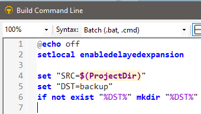
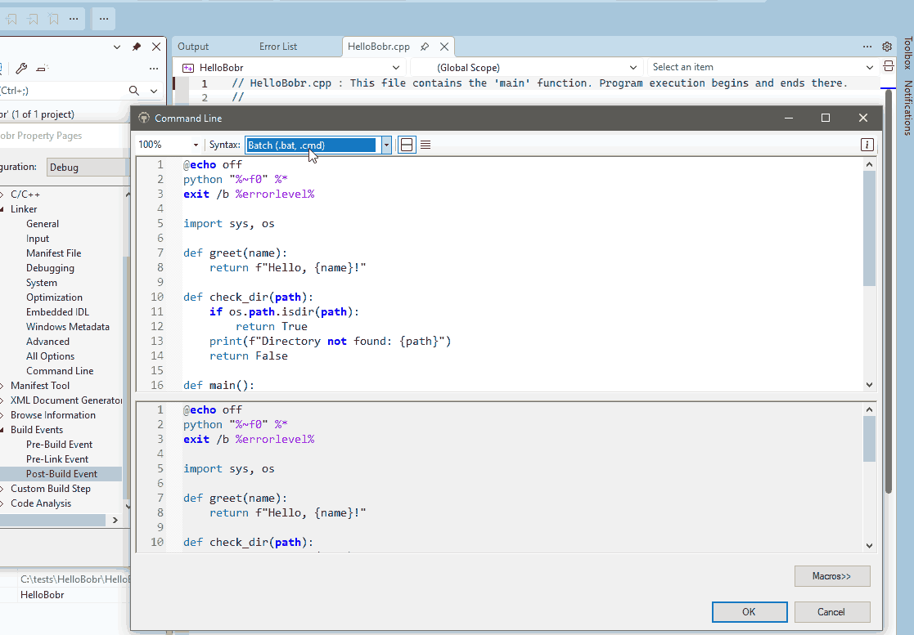
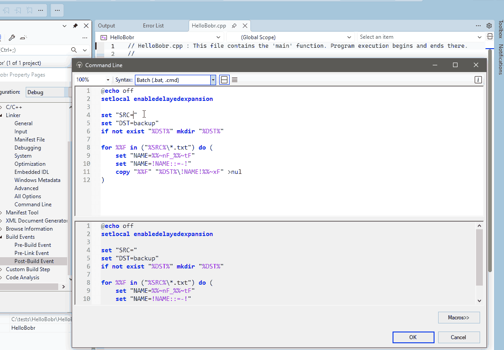
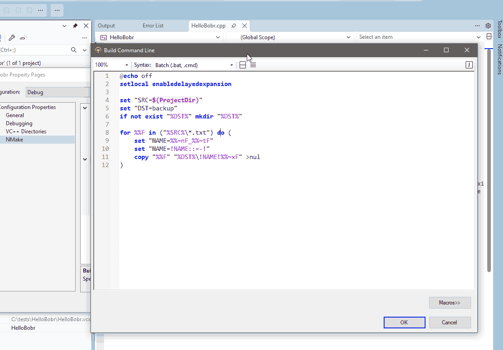
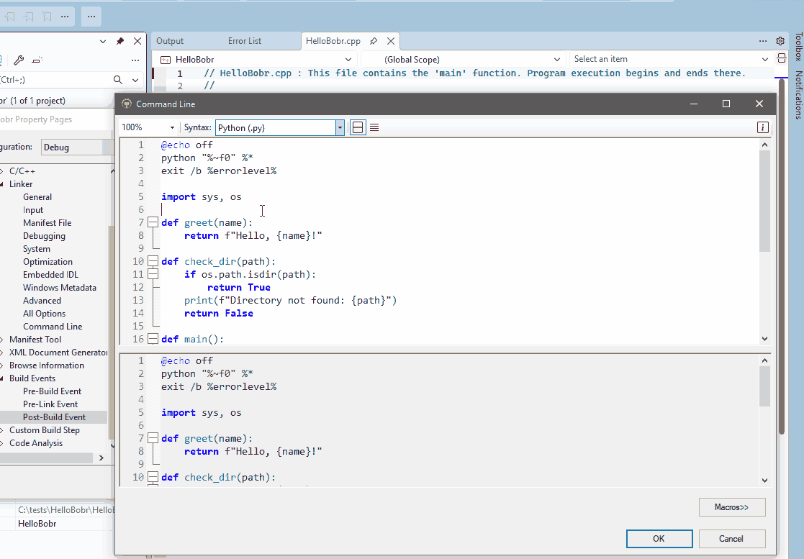
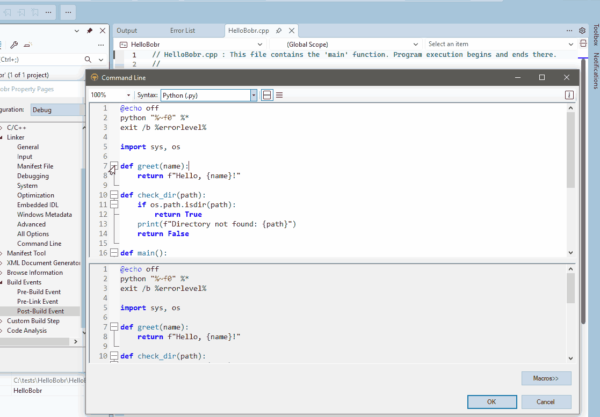

# KosPlay Editors

KosPlay Editors provides advanced value editors for C++ projects.

## Main features

- A monospaced text editor.
- Syntax highlighting.
- Keyword and macro autocompletion.
- Support for NMake projects.
- Support for C++ pre-build, post-build, and custom build steps.
- Visual Studio for Linux: support for Makefile projects.
- Visual Studio for Linux: support for C++ remote pre-build and post-build steps.
- And more.

## Syntax highlighting

- Batch
- PowerShell
- Bash
- Python

## Macro autocompletion

## Flexible layout

## Text scaling

## Synchronized scrolling

## Code folding

## Build from sources

Use **Visual Studio 2026 (18.x)** with the following workloads installed through Visual Studio Installer:

- **.NET desktop development** for the C# and Windows Forms projects.
- **Visual Studio extension development** for the Visual Studio SDK and VSIX tooling.

Ensure that the **.NET Framework 4.7.2 targeting pack** and **.NET Framework 4.7.2 SDK** are installed. These can be selected on the **Individual components** tab in Visual Studio Installer.

Install [HeatWave for Visual Studio](https://marketplace.visualstudio.com/items?itemName=FireGiant.FireGiantHeatWaveDev17) to load and build the WiX installer project (`.wixproj`). The VSIX project uses the Visual Studio SDK tooling. WiX 5.0.2 and the other NuGet dependencies are restored automatically during the build.

1. Open **KosPlay.VisualStudio.Editors.slnx** in Visual Studio.
2. Select **Build > Rebuild Solution**.

## License

MIT
